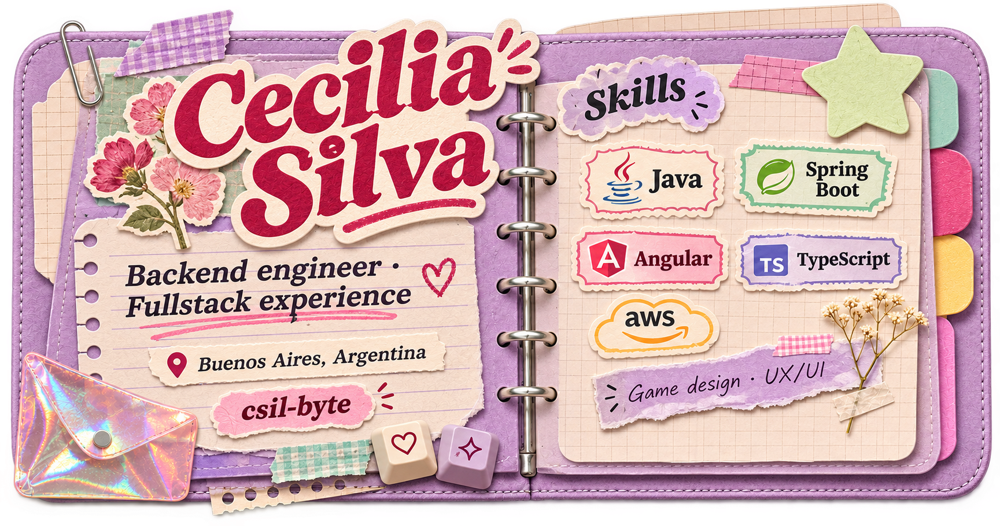

  

  
  

### Hello, I'm Cecilia

I'm a backend engineer with fullstack experience, based in Buenos Aires, Argentina. My background includes Java and Spring Boot microservices, REST APIs, Angular frontends, and production ownership at Mercado Libre, JPMorgan Chase, and UTN.

I'm also interested in game design and UX/UI: how systems behave, how people interact with them, and what makes an experience feel good to use.

Inside my toolkit

| | Technologies |
| --- | --- |
| Backend | Java 17 & 21, Spring Boot, REST APIs, microservices |
| Frontend | Angular, TypeScript, React / React Native |
| Data | PostgreSQL, MySQL, MongoDB, Redis |
| Messaging | Kafka, SQS, RabbitMQ |
| Cloud & infrastructure | AWS, Docker, Kubernetes |
| Observability | Datadog, Kibana, New Relic |

